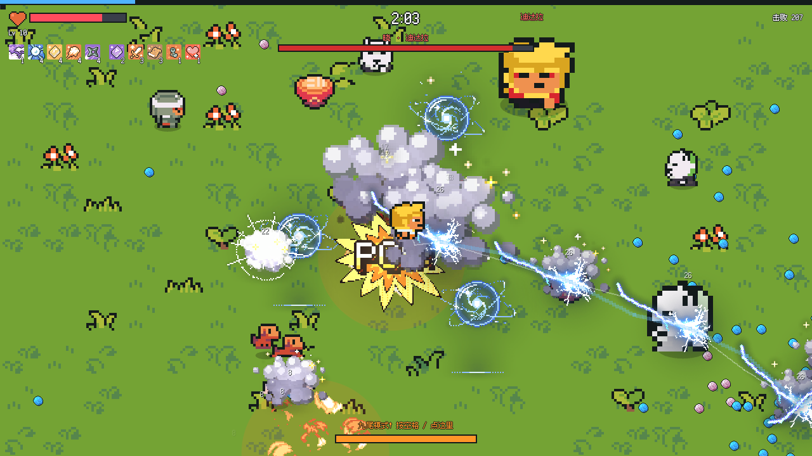

# 忍界幸存者 Ninja Bonk

火影忍者主题的像素风幸存者小游戏（Vampire Survivors / Megabonk 那一类），浏览器打开就能玩，不用安装。



## 怎么玩

下载或 clone 这个仓库，双击 `ninja-bonk.html` 就能开始玩。`assets.js` 要和 HTML 在同一个文件夹。

| 操作 | 电脑 | 手机 |
|---|---|---|
| 移动 | WASD / 方向键 | 按住屏幕拖动（虚拟摇杆） |
| 选角色 / 选升级 | 1 / 2 / 3 或点击 | 点卡片 |
| 放大招 | 空格 | 点屏幕底部的能量条 |

攻击全是自动的。你要做的是走位、捡查克拉（经验）、升级时挑技能。每 2 分钟会来一个晓组织成员当 Boss，看你能活多久。

## 游戏内容

**角色**

| 角色 | 起手忍术 | 特点 | 大招 |
|---|---|---|---|
| 鸣人 | 影分身 | 血量 120 | 九尾模式 |
| 佐助 | 千鸟 | 伤害 +15%，跑得快 | 须佐能乎 |
| 小樱 | 起爆符 | 每秒回血 | 百豪之术（还会回满血） |

大招效果：清掉屏幕上的怪，然后 6 秒无敌，身边有一圈伤害光环。能量靠击杀攒。

**忍术**：6 种，每种最多 5 级。

- 手里剑
- 螺旋丸
- 千鸟
- 豪火球
- 影分身
- 起爆符

**被动道具**：5 种。

- 疾风
- 查克拉强化
- 瞬身术
- 仙人体质
- 通灵契约

**进化**：忍术满级再配上对应的搭档，升级时会出现金框的进化卡。

| 进化 | 条件 |
|---|---|
| 风遁·螺旋手里剑 | 手里剑满级 + 螺旋丸满级 |
| 雷切 | 千鸟满级 + 疾风 |
| 豪火灭却 | 豪火球满级 + 查克拉强化 |

**敌人**

- **白绝**：大群出现，定时还会围成一圈收拢
- **音忍**：站在远处扔苦无
- **忍犬**：三只一群，比你跑得快
- **自爆忍者**：贴身后会爆炸

**Boss**：每 2 分钟来一个晓组织成员，每个人都会冲刺，另外还有专属招式：

| Boss | 专属招式 |
|---|---|
| 迪达拉 | 会拐弯的黏土鸟 |
| 干柿鬼鲛 | 扇形水鲛弹 |
| 角都 | 地怨虞触手 |
| 飞段 | 诅咒阵 |
| 佩恩 | 神罗天征 |

**掉落**

- 一乐拉面：回血
- 通灵卷轴：把全屏的查克拉吸过来
- 宝箱：白送一次升级，能进化就优先进化

## 文件说明

| 文件 | 说明 |
|---|---|
| `ninja-bonk.html` | 游戏本体，所有逻辑都在这一个文件里 |
| `assets.js` | 打包好的图片、特效序列帧和字体（自动生成） |
| `assets/` | 素材原图和授权文件 |
| `tools/build_assets.py` | 改了 `assets/` 之后运行它，重新生成 `assets.js` |
| `CREDITS.md` | 素材来源和授权 |

```bash
python3 tools/build_assets.py
```

素材做成 data URL 打包进 `assets.js`，是为了双击打开（file://）时也能读图片像素，角色换色要靠这一步。

想调难度的话，主要改 `ninja-bonk.html` 里的这几处：

| 位置 | 管什么 |
|---|---|
| `update()` 里"刷怪"那段 | 刷怪速度和数量 |
| `spawnFoe()` | 怪的血量和伤害增长 |
| `FOES` | 各种怪的数值 |
| Boss 生成那段 | Boss 出场间隔和血量 |

## 素材与授权

- 角色、怪物、道具：[Ninja Adventure Asset Pack](https://pixel-boy.itch.io/ninja-adventure-asset-pack)（CC0）
- 特效：[pixelfx](https://github.com/patch-gg/pixelfx)（MIT）
- 字体：[缝合像素字体](https://github.com/TakWolf/fusion-pixel-font)（OFL 1.1）

详见 [CREDITS.md](CREDITS.md)。

人物和名字出自《火影忍者》，本游戏是非官方同人作品，仅供学习交流。
